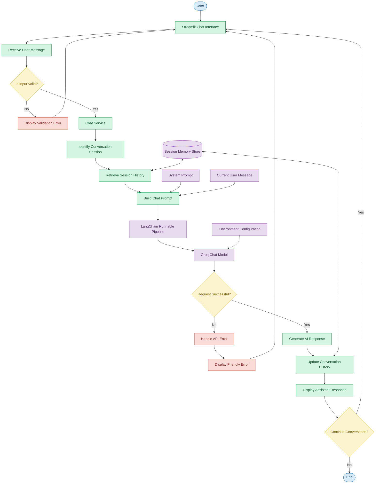

# ConvoCore — LangChain-Based Conversational AI Chatbot

A context-aware conversational AI chatbot built using **Python, LangChain, Groq API, and Streamlit**. This project demonstrates Large Language Model (LLM) integration, prompt engineering, conversational memory, multi-turn interactions, and modular application architecture.

---

## 📌 Project Overview

ConvoCore is an AI-powered conversational chatbot designed to generate intelligent, context-aware responses using a Large Language Model (LLM).

Unlike a basic chatbot that processes every message independently, ConvoCore maintains conversation history within a session, allowing users to ask follow-up questions and receive responses based on earlier interactions.

The application uses **LangChain** to orchestrate interactions between the prompt template, conversation history, and language model. **Streamlit** provides an interactive user interface for communicating with the chatbot.

The project focuses on building a modular, maintainable, and deployment-ready LLM application while demonstrating essential concepts in conversational AI development.

## 🎯 Objectives

* Integrate a hosted LLM using LangChain.
* Design structured system prompts using LangChain prompt templates.
* Implement conversation memory for multi-turn interactions.
* Manage conversation sessions independently.
* Build a modular and reusable Python codebase.
* Securely manage API credentials through environment configuration.
* Implement input validation and error handling.
* Test application components using automated tests.
* Prepare the application for cloud deployment.

## ✨ Key Features

* **LLM Integration:** Connects to a Groq-hosted language model through LangChain.
* **Prompt Engineering:** Uses a structured system prompt to guide assistant behavior.
* **Multi-Turn Conversations:** Uses previous messages to interpret follow-up questions.
* **Conversation Memory:** Maintains message history within a conversation session.
* **Session Management:** Supports independent conversations and conversation clearing.
* **LangChain Orchestration:** Combines prompt templates, message history, and the LLM into a conversational pipeline.
* **Modular Architecture:** Separates configuration, prompting, model initialization, memory, and service logic.
* **Secure Configuration:** Uses environment variables or supported deployment secrets for API credentials.
* **Error Handling:** Handles invalid inputs, missing configuration, and model-provider failures.
* **Interactive Interface:** Provides a conversational interface using Streamlit.
* **Automated Testing:** Supports testing of configuration, prompts, memory, and service behavior.
* **Deployment Preparation:** Includes documentation for cloud deployment and secure configuration.

## 🛠️ Technology Stack

| Technology                | Purpose                                                   |
| ------------------------- | --------------------------------------------------------- |
| Python                    | Core application development                              |
| LangChain                 | LLM orchestration and conversation management             |
| LangChain Core            | Prompt templates, runnable pipelines, and message history |
| Groq API                  | Access to hosted language models                          |
| Streamlit                 | Interactive chatbot interface                             |
| python-dotenv             | Local environment configuration                           |
| pytest                    | Automated testing                                         |
| Ruff                      | Python linting, if configured                             |
| Git                       | Version control                                           |
| GitHub                    | Source code hosting                                       |
| Streamlit Community Cloud | Deployment platform                                       |

---

# 🏗️ System Architecture

ConvoCore follows a modular architecture in which each component has a clearly defined responsibility.

The following flowchart illustrates the expected application workflow, from user input to response generation and conversation-history updates.

## Architecture Flowchart



### Architecture Components

**1. Streamlit Chat Interface**

The frontend allows users to interact with the chatbot.

Responsibilities:

* Accept user messages.
* Display user and assistant messages.
* Show a loading indicator while generating responses.
* Provide conversation controls.
* Display configuration and error messages.

**2. Chat Service**

The service layer coordinates the chatbot's core operations.

Responsibilities:

* Validate user messages.
* Identify the current conversation session.
* Invoke the LangChain pipeline.
* Return generated responses.
* Handle expected application and provider errors.

Separating this layer from the user interface makes the application easier to maintain and test.

**3. Prompt Template**

The prompt template defines how the assistant should respond.

It combines:

* System instructions.
* Relevant conversation history.
* The current user message.

LangChain's chat prompt templates allow these elements to be structured consistently rather than manually concatenating messages.

**4. Conversation Memory**

The memory component maintains message history for individual conversations.

Each session has its own history, allowing the chatbot to use earlier messages when answering follow-up questions.

**5. LangChain Pipeline**

The pipeline connects the prompt template to the language model.

Conceptually:

```text
User Message
     |
     v
Session Identification
     |
     v
Conversation History
     |
     v
Chat Prompt Template
     |
     v
LangChain Runnable Pipeline
     |
     v
Groq-hosted Language Model
     |
     v
Generated Response
     |
     v
Update Conversation History
     |
     v
Display Response
```

The pipeline combines reusable components into a structured processing workflow.

**6. Groq LLM Integration**

The model integration sends the formatted conversational input to a language model hosted by Groq.

The model generates a response, which the application returns to the user.

The model identifier and supported generation settings are configurable, allowing the model to be changed without redesigning the entire application.

**7. Configuration Management**

Configuration settings and API credentials are maintained outside the application source code.

Local development uses environment variables, while deployment can use the hosting platform's secret-management mechanism.

This reduces the risk of accidentally exposing credentials in version control.

---

# 🧠 How Conversation Memory Works

Conversation memory is one of the central features of ConvoCore.

Without conversation history, the language model may not have the information needed to answer questions that refer to earlier messages.

ConvoCore associates message history with a conversation session and supplies the relevant history when processing a new message.

## Example Conversation

**User:**
Hi, my name is Asha.

**Assistant:**
Hi Asha! How can I help you today?

**User:**
I'm preparing for Python interviews.

**Assistant:**
I can help you prepare for Python interviews.

**User:**
Give me a three-day preparation plan.

**Assistant:**
The assistant generates a three-day Python interview preparation plan.

**User:**
What am I preparing for?

**Assistant:**
You're preparing for Python interviews.

The final response uses context from earlier messages in the same conversation rather than relying on a hardcoded answer.

## Session Isolation

Separate conversations should maintain separate histories.

```text
Session A
    |
    |-- User messages
    |-- Assistant responses
    |-- Conversation history A

Session B
    |
    |-- User messages
    |-- Assistant responses
    |-- Conversation history B
```

Creating a new conversation starts a fresh session. Clearing a conversation removes its stored contextual history.

## Memory Implementation

A supported LangChain message-history mechanism can associate messages with a session ID and provide them to the conversational pipeline.

For an initial implementation, in-memory message storage is sufficient to demonstrate session-based conversational behavior.

However, it has important limitations:

* History may disappear when the application process restarts.
* Independent application processes do not automatically share memory.
* Long conversations may require history truncation or summarization.
* In-memory history is not persistent production storage.

A future production version could use Redis or PostgreSQL to store conversation history more reliably.

---

# 📁 Project Structure

The intended modular structure is:

```text
langchain-chatbot/
│
├── app.py
├── requirements.txt
├── requirements-dev.txt
├── .env.example
├── .gitignore
├── README.md
├── Dockerfile
├── .dockerignore
├── pyproject.toml
│
├── chatbot/
│   ├── __init__.py
│   ├── config.py
│   ├── model.py
│   ├── prompts.py
│   ├── memory.py
│   └── service.py
│
├── tests/
│   ├── __init__.py
│   ├── test_config.py
│   ├── test_memory.py
│   ├── test_prompts.py
│   └── test_service.py
│
└── .github/
    └── workflows/
        └── tests.yml
```

*Note: The actual repository may contain fewer files or a slightly different structure, depending on the features implemented.*

| File                          | Responsibility                               |
| ----------------------------- | -------------------------------------------- |
| `app.py`                      | Streamlit application and chat interface     |
| `config.py`                   | Configuration loading and validation         |
| `model.py`                    | Language-model initialization                |
| `prompts.py`                  | System prompt and chat prompt template       |
| `memory.py`                   | Conversation history and session management  |
| `service.py`                  | Input validation and conversational pipeline |
| `requirements.txt`            | Runtime dependencies                         |
| `requirements-dev.txt`        | Development and testing dependencies         |
| `.env.example`                | Example environment configuration            |
| `.gitignore`                  | Excludes secrets and generated files         |
| `tests/`                      | Automated test suite                         |
| `Dockerfile`                  | Optional container configuration             |
| `pyproject.toml`              | Tool configuration                           |
| `.github/workflows/tests.yml` | Automated checks through GitHub Actions      |

---

# ⚙️ Installation and Setup

## Prerequisites

Before running the project, ensure that you have:

* Python 3.12 or another supported Python version compatible with the dependencies.
* Git.
* Visual Studio Code or another Python editor.
* A Groq API key.

## 1. Clone the Repository

```bash
git clone https://github.com/dhanashreejadhav2819-wq/LangChain_based_LLM_chatbot.git
```

Navigate to the project directory:

```bash
cd LangChain_based_LLM_chatbot
```

## 2. Create a Virtual Environment

On Windows PowerShell:

```powershell
py -m venv .venv
```

Activate the environment:

```powershell
.\.venv\Scripts\Activate.ps1
```

On macOS or Linux:

```bash
python3 -m venv .venv
source .venv/bin/activate
```

## 3. Install Dependencies

Upgrade pip:

```bash
python -m pip install --upgrade pip
```

Install the runtime dependencies:

```bash
pip install -r requirements.txt
```

If the project includes development dependencies, install them with:

```bash
pip install -r requirements-dev.txt
```

## 4. Configure the Environment

Create a local `.env` file from `.env.example`.

On Windows PowerShell:

```powershell
Copy-Item .env.example .env
```

Open `.env` and configure the required values.

Example:

```dotenv
GROQ_API_KEY=your_groq_api_key
GROQ_MODEL=your_supported_groq_model
TEMPERATURE=0.3
MAX_TOKENS=700
```

Replace the placeholders with your actual configuration.

Use a currently supported model identifier from Groq's documentation.

**Security note:** Never commit your actual `.env` file or expose your Groq API key in source code, screenshots, logs, or public repositories.

---

# ▶️ Running the Application

From the project directory, activate your virtual environment and execute:

```bash
streamlit run app.py
```

Streamlit will provide a local address, normally:

```text
http://localhost:8501
```

Open the address in your browser to interact with the chatbot.

The application requires valid model-provider configuration to generate real LLM responses.

---

# 🧪 Testing

The project can use pytest to verify configuration, prompting, session isolation, and service behavior.

Run the test suite:

```bash
python -m pytest -q
```

If Ruff is configured, run:

```bash
python -m ruff check .
```

Tests should use mocked model responses where appropriate so that unit tests do not require a real Groq API key or incur model usage costs.

## Recommended Manual Tests

1. Ask the chatbot a basic question.
2. Introduce yourself and ask a related follow-up question.
3. Verify that earlier conversation details are used when relevant.
4. Start a new conversation and check that previous history is not reused.
5. Clear a conversation and verify that cleared messages are no longer available as context.
6. Test behavior when the API key is missing.
7. Test how the application handles a model-provider failure.

Record actual test results before describing the application as fully verified.

---

# 🚀 Deployment

The initial deployment target is Streamlit Community Cloud.

## Deployment Steps

1. Push the project to GitHub.
2. Confirm that `.env` and other secret-containing files are excluded from version control.
3. Open Streamlit Community Cloud.
4. Create an application from the GitHub repository.
5. Select the appropriate branch and `app.py` as the entrypoint.
6. Configure the required environment settings and secrets.
7. Deploy the application.
8. Inspect application logs for startup errors.
9. Test multi-turn conversations and session isolation in the deployed application.

For deployment, configure secrets using the hosting platform's secret-management settings rather than committing credentials to GitHub.

## Future Production Improvements

The initial application can be extended with:

* Persistent conversation storage using Redis or PostgreSQL.
* Authentication and authorization.
* More robust session ownership and lifecycle management.
* Rate limiting and usage controls.
* Request timeouts and bounded retries.
* Structured logging and monitoring.
* LangSmith tracing for debugging LangChain execution.
* A FastAPI backend for integration with other frontend applications.
* Docker-based deployment.
* Automated CI testing.

These improvements should be implemented and verified before the application is described as production-ready for demanding real-world workloads.

---

# 🔐 Security Considerations

* Keep API keys outside source control.
* Exclude `.env` and deployment secrets from Git.
* Validate user input before calling the LLM.
* Avoid exposing raw exceptions to end users.
* Avoid logging secrets or unnecessary conversation contents.
* Use appropriate input and output limits.
* Configure access control when exposing the application publicly.
* Remember that messages sent to a hosted LLM may be processed by the model provider.

The security and privacy properties of the application depend on its actual configuration, storage design, hosting environment, and provider policies.

---

# 💡 Design Decisions

## Why LangChain?

LangChain provides reusable components for prompt construction, model integration, and runnable pipelines. This makes the application easier to organize than a single function containing all conversational logic.

## Why Groq?

Groq provides access to hosted language models through an API, allowing the project to focus on LLM application development rather than model-serving infrastructure.

## Why Streamlit?

Streamlit makes it possible to create an interactive Python-based chatbot interface without introducing a separate frontend framework.

## Why Modular Python Code?

Separating model initialization, prompting, memory, configuration, and service logic improves maintainability and testability.

## Why In-Memory Conversation History?

In-memory history keeps the initial implementation simple and demonstrates session-based conversation management. Persistent storage can be introduced when application requirements justify it.

## Why Environment-Based Configuration?

External configuration allows credentials and model settings to be changed without modifying application source code.

---

# ⚠️ Limitations

The initial implementation may have the following limitations, depending on its current configuration:

* Conversation history may not survive process restarts.
* Model responses depend on the selected model and provider availability.
* LLM outputs may be inaccurate.
* Long conversations may require history truncation or summarization.
* Public deployment may require additional access control and usage limits.
* Persistent storage, authentication, and production monitoring require additional implementation.

---

# 🔮 Future Enhancements

Potential future improvements include:

* Persistent conversation history.
* Conversation export.
* Multiple configurable model providers.
* Streaming responses.
* User authentication.
* Conversation search.
* Token and usage tracking.
* Feedback collection.
* Improved monitoring and evaluation.
* A React frontend backed by FastAPI.

These enhancements are future possibilities, not claims about features already implemented.

---

# 👩‍💻 Author

**Dhanashree Jadhav**

Bachelor of Engineering — Artificial Intelligence and Data Science

**Project:** LangChain-Based Conversational AI Chatbot

**GitHub Repository:** [LangChain_based_LLM_chatbot](https://github.com/dhanashreejadhav2819-wq/LangChain_based_LLM_chatbot)

---

# 📄 License

Choose an appropriate open-source license before distributing the project. If you choose the MIT License, include a `LICENSE` file containing the appropriate license text.

---

**ConvoCore demonstrates the fundamentals of building an LLM-powered conversational application, from prompt engineering and LangChain orchestration to session-based memory, modular software design, testing, and deployment preparation.**
