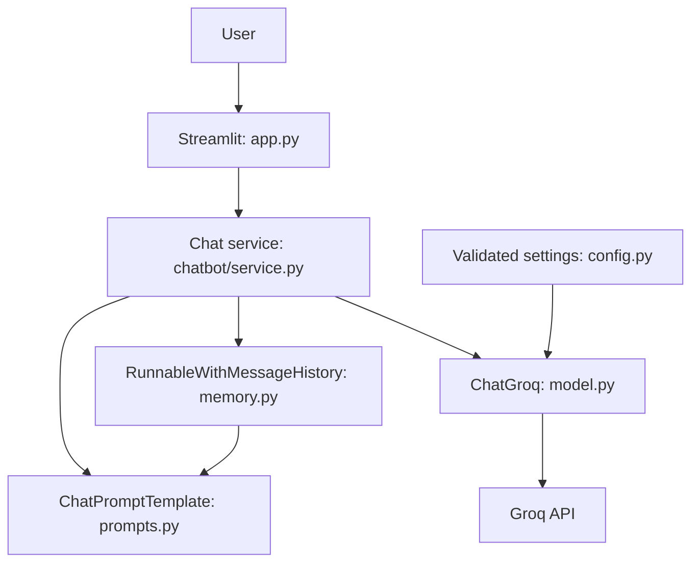

# ConvoCore

**LangChain-Based Context-Aware Conversational AI Chatbot**

ConvoCore is a small, interview-friendly conversational AI application built with Python, Streamlit, LangChain, and Groq. It demonstrates prompt engineering, a runnable LLM pipeline, multi-turn message history, configuration management, validation, and testable service logic.

## Problem and objectives

A single-turn prompt cannot reliably answer follow-up questions that refer to earlier messages. ConvoCore demonstrates how a chat prompt and session-specific message history give an LLM the context needed for a useful multi-turn conversation, while keeping provider configuration and UI concerns separate.

## Features and technology

- Groq-hosted chat model through LangChain's `ChatGroq` integration.
- `ChatPromptTemplate` with system instructions, a history placeholder, and the current question.
- Explicit session history injection into the LangChain runnable pipeline.
- Streamlit controls for a new chat and clearing the current chat.
- Environment variables, `.env` for local development, and Streamlit secrets for hosting.
- Optional password gate, bounded input size, timeouts, retries, friendly errors, and server logging.
- pytest unit tests with mocked model behavior; GitHub Actions and Ruff configuration.

## Architecture



| Module | Responsibility |
|---|---|
| `app.py` | Streamlit presentation, session state, access gate, and error display |
| `chatbot/config.py` | Environment loading and validation of model/runtime settings |
| `chatbot/prompts.py` | System prompt and LangChain chat prompt template |
| `chatbot/model.py` | Configured `ChatGroq` factory |
| `chatbot/memory.py` | In-memory history store keyed by conversation session ID |
| `chatbot/service.py` | Input validation, chain invocation, and safe error handling |
| `tests/` | Provider-independent settings, prompt, memory, and service tests |

## LangChain orchestration and memory

`build_prompt()` creates a `ChatPromptTemplate` in this order: system instructions, `MessagesPlaceholder("history")`, then the current human question. The service composes that prompt with the model using LCEL (`prompt | model`). For each request, the service loads the server-generated session's LangChain message objects, supplies them through the placeholder, and writes the user/assistant pair after a successful response. This uses current LangChain prompt/runnable APIs directly and makes the memory update path explicit.

The system prompt asks the assistant to be clear, helpful, appropriately concise, honest about uncertainty and capabilities, and to use relevant context without exposing secrets. A session's history is not shared with another session. New Conversation assigns a new random ID; Clear Conversation deletes only the active history. The UI renders its own message list, while LangChain owns model context; history is added to the UI only after a successful model response.

The initial store is in process memory: it disappears at restart and is not shared between multiple app workers. Use a persistent store such as Redis or PostgreSQL, plus authenticated user-to-session authorization and retention controls, for a multi-instance or production service. This demo does not claim enterprise privacy. User messages are sent to Groq to generate responses.

## Requirements

- Python 3.11 or 3.12
- A Groq API key
- Internet access when making model requests

The default model `openai/gpt-oss-20b` is listed in Groq's [supported models](https://console.groq.com/docs/models). Model availability and account access can change; choose a supported model in the Groq console if needed.

## Local setup (Windows PowerShell)

From the repository directory:

```powershell
py -3.12 -m venv .venv
.\.venv\Scripts\Activate.ps1
python -m pip install --upgrade pip
pip install -r requirements-dev.txt
Copy-Item .env.example .env
notepad .env
```

Set `GROQ_API_KEY` in `.env` to a newly rotated key, save the file, then run:

```powershell
python -m streamlit run app.py
```

Open the local URL Streamlit prints (normally `http://localhost:8501`). Do not paste a key into Python, README, issue, screenshot, or Git. `.env` is ignored by Git. For macOS/Linux, use `python3 -m venv .venv`, activate with `source .venv/bin/activate`, then use the same pip and Streamlit commands.

## Configuration

| Variable | Required | Default | Purpose |
|---|---:|---|---|
| `GROQ_API_KEY` | Yes for requests | Empty | Groq credential |
| `GROQ_MODEL` | No | `openai/gpt-oss-20b` | Groq model ID |
| `TEMPERATURE` | No | `0.3` | Sampling temperature (0–2) |
| `MAX_TOKENS` | No | `700` | Maximum generated tokens |
| `REQUEST_TIMEOUT_SECONDS` | No | `30` | Request timeout |
| `MAX_QUESTION_CHARS` | No | `8000` | Maximum user message size |
| `APP_ACCESS_PASSWORD` | No | Empty | If set, requires a password per browser session |

Local settings are loaded by `python-dotenv` without replacing existing environment values. Hosted Streamlit secrets are read from `st.secrets`. The password gate is a basic shared-password barrier; it is not user authentication or a substitute for authorization and rate limiting. If no password is configured on a public deployment, visitors can use the app and consume the configured API quota.

## Example multi-turn conversation

**User:** My name is Asha.

**Assistant:** Nice to meet you, Asha!

**User:** I'm preparing for Python interviews.

**Assistant:** I can help you prepare for Python interviews.

**User:** What am I preparing for?

**Assistant:** You're preparing for Python interviews.

Responses are generated by the model using the current conversation history; this is not a hardcoded special case. Exact wording can vary.

## Tests and lint

```powershell
python -m pytest -q
python -m ruff check .
python -m compileall chatbot app.py
```

Unit tests mock the model and require no API key or paid request. Manual end-to-end check: configure a valid key, start the app, share a detail then ask about it, try New Conversation and Clear Conversation, and check a failed/missing credential produces a safe setup message. Check Streamlit's terminal output for server logs; message bodies and secrets are not logged intentionally.

## Common issues

- **Missing key:** add `GROQ_API_KEY` to `.env`, restart Streamlit, and ensure the key is active.
- **Model not found/unsupported:** use a model ID listed in the Groq console and restart the app.
- **Rate limit/network issue:** wait and retry; the app uses a timeout and bounded retries and does not invent an answer after a failed request.
- **PowerShell activation blocked:** use `\.venv\Scripts\python.exe -m pip ...` and `\.venv\Scripts\python.exe -m streamlit run app.py` without activating the environment.
- **Package/import error:** activate `.venv` and rerun `pip install -r requirements-dev.txt`.

## GitHub preparation and CI

The workspace provided for this task is not initialized as a Git repository, so no Git status, staged-file, or commit review could be performed. Before creating a repository, inspect `.env` locally and verify it is ignored; never stage it. The GitHub Actions workflow installs dependencies and runs pytest and Ruff without a Groq secret. Repository URL: **[add after creation]**.

## Deploy to Streamlit Community Cloud

1. Create/select a GitHub repository and push source after reviewing staged files for secrets. Do not push `.env`.
2. In Streamlit Community Cloud, create an app using the repository, branch, and `app.py` entrypoint.
3. Add secrets under app settings in TOML format, using a rotated key:

   ```toml
   GROQ_API_KEY = "your_rotated_key"
   GROQ_MODEL = "openai/gpt-oss-20b"
   TEMPERATURE = "0.3"
   MAX_TOKENS = "700"
   APP_ACCESS_PASSWORD = "set_a_shared_password_if_needed"
   ```

4. Deploy, inspect startup logs, and test configuration, multi-turn memory, new/clear conversation, and access control.

The app has not been deployed. Live URL: **[add after deployment]**. Screenshot: **[add after capturing one]**. See [Streamlit Community Cloud deployment](https://docs.streamlit.io/deploy/streamlit-community-cloud/deploy-your-app/deploy) and [secrets management](https://docs.streamlit.io/deploy/streamlit-community-cloud/deploy-your-app/secrets-management).

## Optional Docker

Build and run from the project directory, passing credentials only at runtime:

```powershell
docker build -t conv_core .
docker run --rm -p 8501:8501 --env-file .env conv_core
```

Add optional settings with more `-e NAME=value` flags. Do not pass keys as build arguments or bake them into the image. The image runs as a non-root user and has a Streamlit health check.

## Design decisions, limitations, and future work

- LCEL and `RunnableWithMessageHistory` keep prompt composition and history behavior visible for learning.
- In-memory storage keeps the first version simple but loses data on restart and does not coordinate across replicas.
- The optional shared password is intentionally basic; production needs identity-aware authentication, authorization, request quotas, and persistent storage.
- Conversation context sent to the provider is subject to the provider's policies; do not submit sensitive information.
- No RAG, agent framework, or database is included because the core assignment is conversational memory.
- Future work: database-backed per-user histories, explicit retention/deletion policy, per-user usage limits, richer metrics, and deployment-specific authentication.

## References

- [Groq supported models](https://console.groq.com/docs/models)
- [LangChain Groq integration](https://docs.langchain.com/oss/python/integrations/chat/groq)
- [LangChain message history](https://reference.langchain.com/python/langchain-core/runnables/history/RunnableWithMessageHistory)
- [Streamlit deployment](https://docs.streamlit.io/deploy/streamlit-community-cloud/deploy-your-app/deploy)
# LangChain_based_LLM_chatbot

# LangChain_based_LLM_chatbot

# LangChain_based_LLM_chatbot

